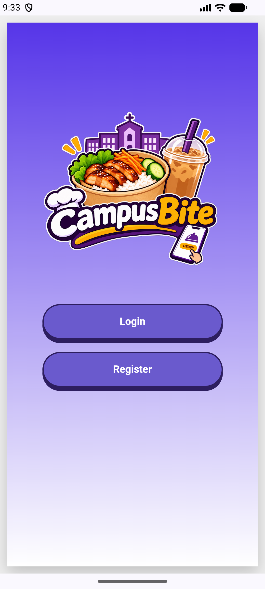
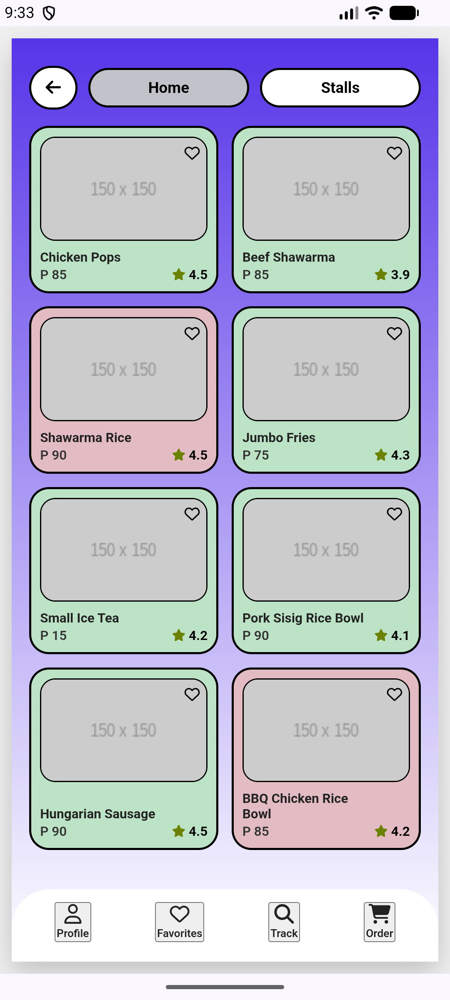
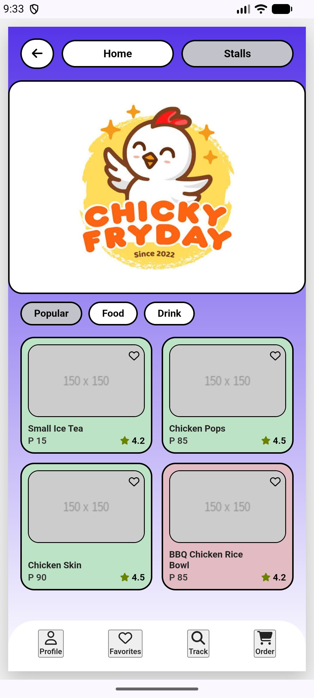
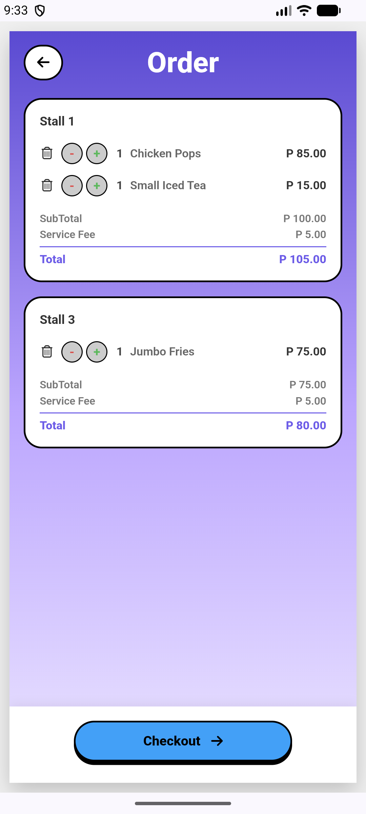
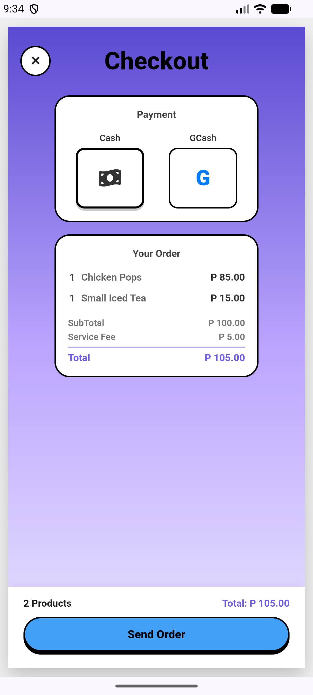
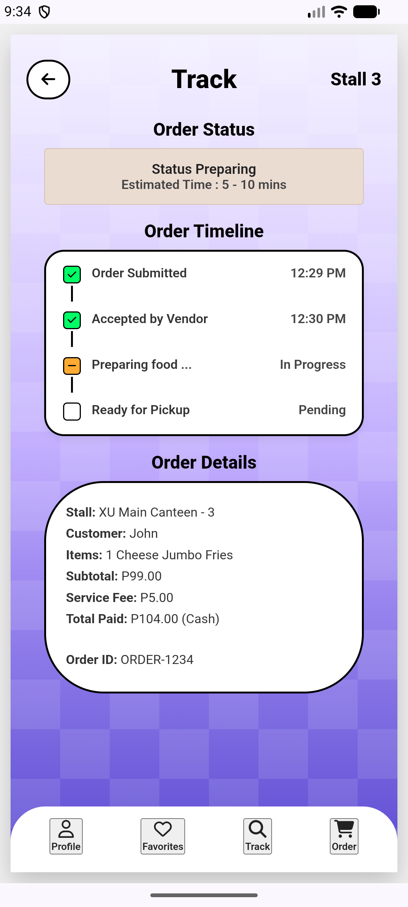
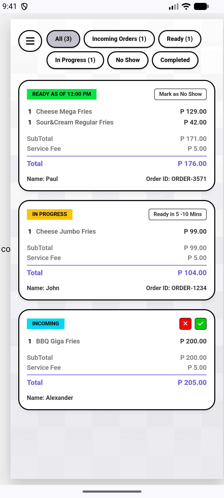

## Implemented Screens 
Register/Login Screen

Home/Food Stalls Screen

Stall Menu Screen

Order Tab Screen

Checkout Screen

Track Order Screen 
 

Vendor Dashboard 

(temporarily accessed through register button for testing/demonstration purposes)

## Brief Progress Report
Implemented the major screens of milestone 1, with still a need for refinement. There are still minor screens that will be worked on and logic with the screens. Problems encountered were with design but with the help of the web and use of online tools, we were able to resolve it, make it clear and understable the design to work with alongside the html files. 